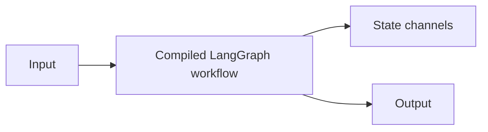
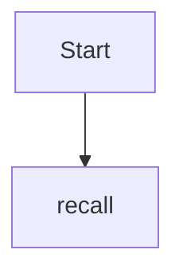

# 26. Long-Term Memory

## A. Learning Objectives

- Store
- Retrieve
- Namespace
- Memory search
- Semantic memory
- Episodic memory
- User-specific memory
- Memory updates

## B. Concept Explanation

PostgreSQL keeps durable facts and the LangGraph store provides namespaced retrieval through a rebuilt index. The same key supports updates. Semantic search and episodic history serve different retrieval needs.

**Application.** Personalized AI assistant with persistent user memory. State is useful when downstream steps need an explicit record of prior decisions. Each additional channel expands the data that must be tested and, for checkpointed graphs, stored. A common mistake is mutating state directly instead of returning a patch.

## C. Architecture





The CLI supplies the sample input. The graph runs the nodes and merges their state updates. The test calls the same implementation with fixtures and checks observable behavior. Read the edge declarations for the exact routing rules.

## D. Prerequisites

Node.js 24 and pnpm 11. Complete the earlier graph and state lessons first. Services for the demo: Ollama and PostgreSQL.

## E. Initial Project Setup

PowerShell, from this project folder:

```powershell
Copy-Item .env.example .env
pnpm install
```

Git Bash:

```bash
cp .env.example .env
pnpm install
```

## F. Exercises Without Answers

**Difficulty:** Expert

**Problem.** Personalized AI assistant with persistent user memory.

- **Requirements.** Implement the stages in the graph and verify the scenario with an automated test.
- **Input example.** Which editor does Ada prefer?.
- **Expected behavior.** Ada's updated preference is retrieved without another user's memory.
- **Hint.** List the values each stage reads and writes before connecting the edges.


## G. Complete Solutions

[Solution walkthrough](solutions/README.md) · [Graph](src/graph/workflow.ts) · [CLI](src/index.ts) · [Tests](tests/workflow.test.ts)

## H. Deep Code Explanation

PostgreSQL keeps durable facts and the LangGraph store provides namespaced retrieval through a rebuilt index. The same key supports updates. Semantic search and episodic history serve different retrieval needs.

Start at the state declaration and identify the channels read by each node. Follow the edges outward from START. Each node emits its update, the graph commits or merges updates for the step, and the selected successor receives the next state. For checkpointed examples, inspect committed state with the same thread ID.

## I. Execution

If the demo uses shared services, start them once from the archive root using `powershell -ExecutionPolicy Bypass -File infrastructure/scripts/init.ps1` or `bash infrastructure/scripts/init.sh`. Return to this project and use `pnpm health` to check Ollama when applicable.

```text
pnpm install
pnpm typecheck
pnpm test
pnpm start
```

Stop a long-running CLI or API with Ctrl+C. Stop the shared services from the root with `docker compose -f infrastructure/docker-compose.yml down`.

## J. Expected Output

For the sample in `src/index.ts`, look for the following outcome. Model-generated wording can vary.

```text
VS Code
```

## K. Challenge Exercises

1. Store an episodic note durably.
2. Test two owner namespaces.
3. Change the embedding model and rebuild the index.

## L. Interview Questions

1. **How does updating memory avoid duplicates?** Reuse the key in the same namespace.

2. **How is this example implemented?** PostgreSQL keeps durable facts and the LangGraph store provides namespaced retrieval through a rebuilt index. The same key supports updates. Semantic search and episodic history serve different retrieval needs.

3. **What happens if two branches write one channel?** Declare a reducer for that channel or consolidate the writes at a join.

4. **How can you test a model-backed node during CI?** Inject a deterministic model or function, then assert the resulting state and edges.

5. **A workflow returns an unexpected final value. Where do you look first?** Inspect updates for the earliest node that produced an unexpected write, then check its inputs and reducer.

## M. Debugging

If imports fail, run pnpm install with Node 24. If Ollama fails, run pnpm health and check the model tag and port. If a state value is missing, inspect the responsible node's returned patch and the state schema.

## N. Knowledge Check

- Which state fields exist before the first node runs?
- Which node can change the sample result and what does it read?
- Which behavior would you test without the external services?
